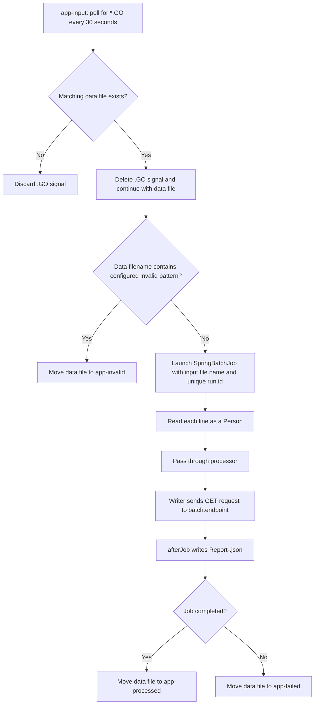

# Spring Batch file-processing example

This application uses Spring Integration to watch an input directory for signal
files and launches a Spring Batch job for each matching data file. Spring Batch
startup auto-launch is disabled; jobs are launched by the file flow.

## Run

Start the local PostgreSQL container first:

```shell
./scripts/start-postgres.sh
```

On macOS, the script can also find the Docker CLI bundled inside Docker
Desktop if it is not on `PATH`. If Docker is installed elsewhere, set
`DOCKER_BIN` to the CLI executable path before running the script.

The script creates (or starts, if already present) a persistent PostgreSQL 17
container named `spring-batch-db`, publishes port `5432`, and stores database
files in the `spring-batch-db-data` Docker volume. It creates a `springbatch`
database and user. The development password defaults to `springbatch`; override
the initial container settings with `POSTGRES_DB`, `POSTGRES_USER`,
`POSTGRES_PASSWORD`, or `POSTGRES_PORT` when running the script.

The app's default connection matches these settings. Start it from the
repository root so relative directories and report files use the repository
root as their working directory:

```shell
./gradlew :adapter:bootRun
```

The app connection can be overridden with `DB_URL`, `DB_USERNAME`, and
`DB_PASSWORD`; if you customized the container settings, pass the matching
values to the app. For example:

```shell
DB_URL=jdbc:postgresql://localhost:5432/my_batch_db \
DB_USERNAME=my_user DB_PASSWORD=my_password \
./gradlew :adapter:bootRun
```

Batch metadata is stored in the PostgreSQL database using Spring Batch's JDBC
repository. On startup, an idempotent PostgreSQL schema script creates the
metadata tables and sequences if they do not already exist. To run without
PostgreSQL, activate the `memory` profile; it uses an H2 in-memory database:

```shell
./gradlew :adapter:bootRun --args='--spring.profiles.active=memory'
```

The test suite activates the `test` profile and uses a separate H2 in-memory
database, so tests do not require PostgreSQL or Docker.

## Ask questions about batch metadata

The `springai-batch-metadata-client` module is a separate REST service. It
connects to the same PostgreSQL database using the `SBDB_URL`,
`SBDB_USERNAME`, and `SBDB_PASSWORD` environment variables used by the batch
app. It reads Spring Batch execution metadata only; it does not expose raw
input-file contents.

Install/start Ollama and pull the default tool-capable model:

```shell
ollama pull qwen3:8b
```

With PostgreSQL and Ollama running, start the service:

```shell
./gradlew :springai-batch-metadata-client:bootRun
```

It listens on port `8081` by default. Submit a natural-language question:

```shell
curl -X POST http://localhost:8081/api/metadata/ask \
  -H 'Content-Type: application/json' \
  -d '{"question":"How many files completed today and how many records were read from each?"}'
```

The same module includes a Thymeleaf UI at `http://localhost:8081/`; enter a
question there to view its answer in the browser. The JSON endpoint remains
available for other clients.

The JSON response contains an `answer` generated by Spring AI. The model can
call read-only tools that summarize completed/unsuccessful jobs and per-file
read/write counts for today or a specified date. File details are capped at
the 100 most recent executions; aggregate totals still cover all executions.
Configure Ollama with `OLLAMA_BASE_URL` and `OLLAMA_MODEL`, and the HTTP port
with `SERVER_PORT`.

## Submit an input file

Place a text data file and a matching `.GO` signal file in `app-input`. The
signal filename must be the data filename with `.GO` appended. For example:

```text
app-input/
  customers.txt
  customers.txt.GO
```

The `.GO` file is a signal only; the batch reader processes `customers.txt`.
Each line in the data file is read as one `Person`. By default, data filenames
containing `app-data` are rejected and moved to `app-invalid`; other filenames
are processed.

The default flow is:



In short, the flow polls `app-input` for `*.GO` signal files, checks for the
matching data file, rejects filenames containing the configured invalid
filename pattern, and launches the batch job for accepted files. The job reads
each line as a `Person`, passes it through the processor, and the writer issues
a GET request to the configured endpoint. The `afterJob` listener writes a
`Report-<data-filename-without-extension>.json` report in the application
working directory before the input file is moved.

For example, processing `customers.txt` creates
`Report-customers.json`. Report files are separate from the processed/failed
input directories.

## Configuration

The defaults are in `config/application.yml`:

| Property | Default | Purpose |
| --- | --- | --- |
| `spring.datasource.url` | `jdbc:postgresql://localhost:5432/springbatch` | Main-profile PostgreSQL connection URL (`DB_URL` override) |
| `spring.datasource.username` | `springbatch` | Database user (`DB_USERNAME` override) |
| `spring.datasource.password` | `springbatch` | Local-development password (`DB_PASSWORD` override) |
| `flow.inputDirectory` | `app-input` | Directory polled for signal and data files |
| `flow.pollingFrequency` | `30000` | Polling interval in milliseconds |
| `flow.invalidFilenamePattern` | `app-data` | Filename substring that causes an input file to be rejected |
| `flow.invalidDirectory` | `app-invalid` | Destination for rejected data files |
| `flow.processedDirectory` | `app-processed` | Destination for successfully processed files |
| `flow.failedDirectory` | `app-failed` | Destination for files whose jobs fail |
| `batch.jobName` | `SpringBatchJob` | Batch job name |
| `batch.stepName` | `StepOne` | Batch step name |
| `batch.chunkSize` | `1000` | Items written per chunk |
| `batch.endpoint` | `https://httpbin.org/get` | Endpoint called by the item writer |

These paths are relative to the application working directory unless configured
as absolute paths. Boot's `spring.batch.job.enabled` is `false`, so the job will
not start automatically without an input file.
